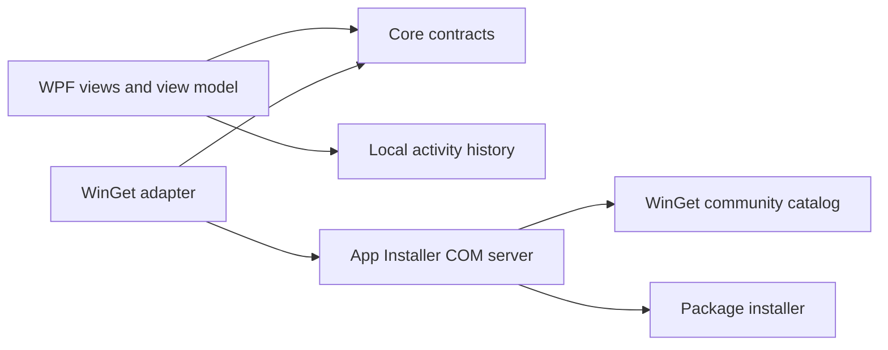

# WingetUI

WingetUI is a Windows 11 x64 desktop client for the WinGet community source. It opens on Updates and includes Search, Installed, and Activity. Install and upgrade requests show the exact target and version before they enter a serial queue.

## Run a local build

Use Windows 11 x64 with current App Installer registered for your account. Extract the entire ZIP and double-click **WingetUI.exe**. The ZIP bundles .NET. Keep the supporting files next to the executable. Delete the extracted folder to remove the application. Delete the WingetUI folder under LocalAppData to remove its local activity history.

## Build and validate

Install the .NET 10 SDK. From the repository root:

```powershell
dotnet publish src/WingetUI.App/WingetUI.App.csproj -c Release -r win-x64 --self-contained true -o .local/publish
Compress-Archive -Path .local/publish/* -DestinationPath .local/WingetUI-win-x64.zip -Force
dotnet publish tests/WingetUI.Smoke -c Release -r win-x64 --self-contained true -o .local/smoke
& ./.local/smoke/WingetUI.Smoke.exe
```

The smoke test queries the live community catalog and installed inventory. It makes no package changes. CI compiles the test and publishes a ZIP. Run live checks under the Windows account whose App Installer registration the app should use.

## Architecture



WPF owns the confirmation dialog and queue. The adapter keeps COM types on its side of the contract and rechecks package identity and version before calling WinGet. On restart, unfinished operations appear as unknown and inventory refreshes. The application never retries them automatically.

## Troubleshooting and verification status

If inventory is unavailable, run `winget --version` in the same Windows account and check that App Installer is installed and current. If search works but inventory is unavailable, refresh before submitting any package request. Use official WinGet commands for agreements that cannot be completed in the app.

The application starts unelevated and asks WinGet for interactive installer mode. Host validation covers Windows build 26200 and App Installer 1.29.380.0. The deployment targets Windows build 26100 and uses WinGet ComInterop 1.29.380. Controlled installs, upgrades, UAC outcomes, active cancellation, localization, and SDK-free clean-machine verification are still pending.

Use **Restart as administrator** before selecting a batch to approve elevation for the app session. The app refreshes in the new process and requires a fresh confirmation. In an elevated session, WingetUI requests silent installer mode. Actual prompt behavior depends on WinGet and the installer.
