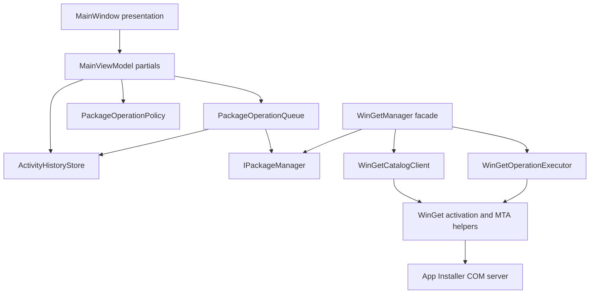
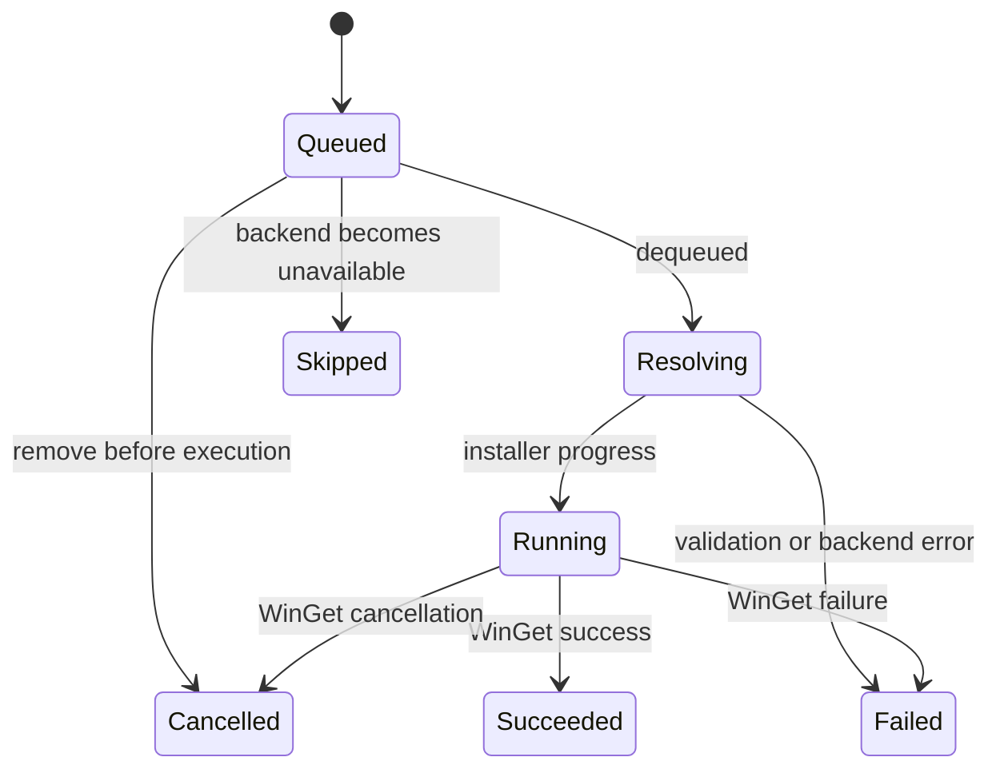

# Architecture

WingetUI is split into three production projects and two executable verification projects.

## Components

### Core

`WingetUI.Core` owns immutable package records, operation contracts, result models, status names, and pure queue policy. It has no dependency on the UI, filesystem, or WinGet COM types.

### Application

`WingetUI.App` owns WPF presentation, application state, the serial operation queue, activity persistence, theme selection, single-instance behavior, and administrator restart. The view model is divided by user workflow: inventory, search, and operations.

Activity JSON is an application-owned local format. The history store validates deserialized records at the persistence boundary and retains all unfinished operations plus the latest 100 completed records.

### WinGet adapter

`WingetUI.WinGet` contains all App Installer COM interaction. The catalog client maps external data into core package records. The operation executor resolves the exact package again immediately before installation, validates that installed and available versions have not changed, and maps WinGet progress and results into core operation models.

`WinGetManager` remains the small public facade used by application composition. COM objects never cross the adapter boundary.

## State and operation lifecycle

The queue is the single source of truth for activity entries. Update rows hold only a reference to their current activity entry so status is not copied into competing state. Search cancellation is owned by the view model and old searches cannot replace a newer query result.

## Error boundaries

- The WinGet adapter converts known external failures into actionable package-operation results or typed backend-availability errors.
- The queue isolates package-local failures so one package does not normally stop a batch. A backend-availability failure skips remaining work because further calls cannot succeed.
- The history store reports I/O failures to the presentation layer without aborting package work.
- The window owns user confirmations and clipboard feedback because those are presentation concerns.
