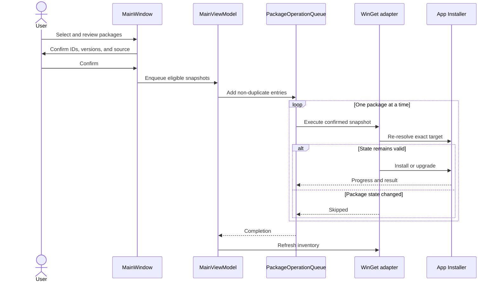
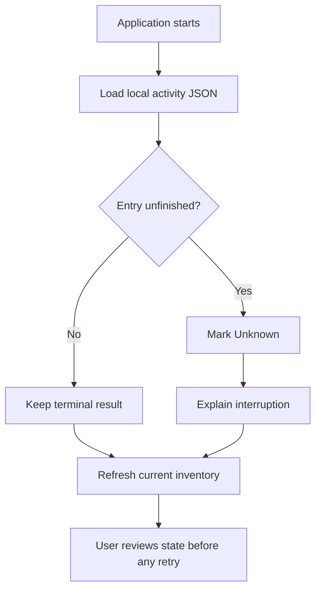

# System diagrams

The authoritative component and lifecycle diagrams are maintained in [architecture](architecture.md). This page documents the user-confirmation and recovery flows that cross presentation, application, and WinGet boundaries.

## Package operation flow

## Interrupted-operation recovery

WingetUI never infers success from process termination and never automatically retries an interrupted package operation.
