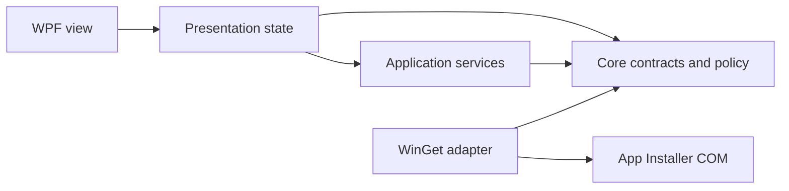

# Refactoring plan

The desktop preview currently works, but its two main implementation files combine unrelated responsibilities. `MainViewModel` coordinates presentation state, search cancellation, inventory, operation queueing, and JSON persistence. `WinGetManager` combines COM activation, catalog discovery, result mapping, target validation, and installer execution.

The refactor preserves current behavior and moves responsibilities into the following structure:

```text
src/WingetUI.Core/
  Packages/Package.cs
  Operations/IPackageManager.cs
  Operations/OperationModels.cs
  Operations/PackageOperationPolicy.cs

src/WingetUI.App/
  Models/ActivityEntry.cs
  Models/UpdateRow.cs
  Services/ActivityHistoryStore.cs
  Services/PackageOperationQueue.cs
  Services/ThemeManager.cs
  Services/AdministratorSession.cs
  Services/SingleInstanceGuard.cs
  MainViewModel.cs
  ViewModels/MainViewModel.Inventory.cs
  ViewModels/MainViewModel.Search.cs
  ViewModels/MainViewModel.Operations.cs
  MainWindow.xaml(.cs)

src/WingetUI.WinGet/
  Activation/ComApartment.cs
  Activation/MtaThreadRunner.cs
  Activation/WinGetActivationFactory.cs
  Catalog/WinGetCatalogClient.cs
  Operations/WinGetOperationExecutor.cs
  WinGetManager.cs
```

Core contains framework-independent contracts and operation policy. App services own stateful queueing and local persistence. The view model translates services into bindable presentation state. The WinGet project keeps COM objects within its adapter boundary.

The current XAML and `IPackageManager` behavior remain compatible. Existing activity JSON fields remain readable. The refactor intentionally makes no user-facing behavioral change.

## Dependency direction



Core does not depend on WPF, WinGet COM, or persistence. Application services depend only on core contracts and app-owned models. The view model coordinates those services and exposes bindable state. The WinGet facade is the composition boundary for activation, catalog access, and operation execution.
